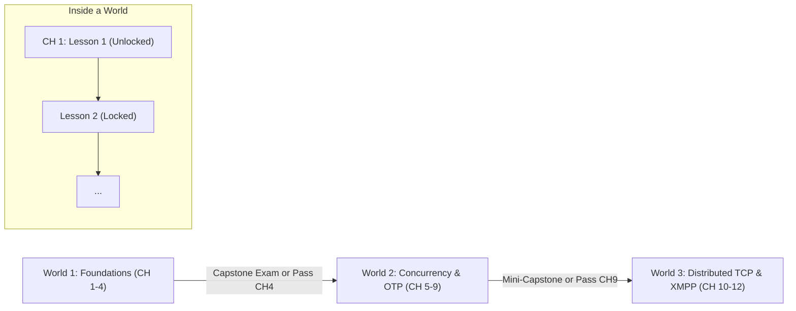
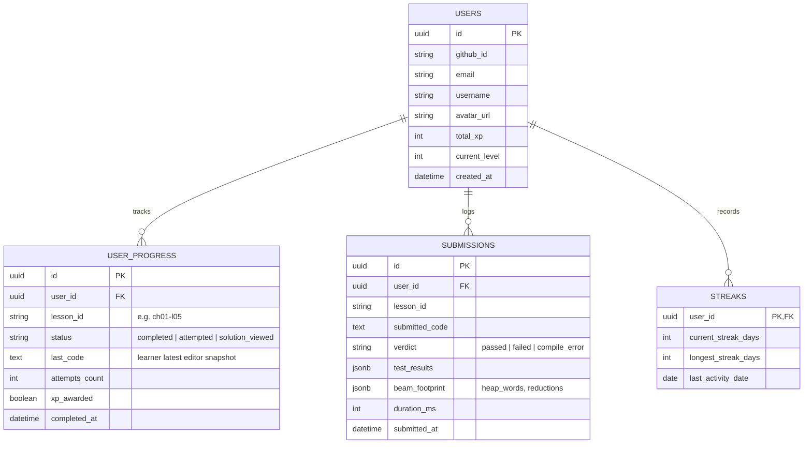

Searched "boot.dev" gamification xp solution unlock hidden tests
Searched "guest mode" coding platform onboarding conversion localStorage account migration

Here is an in-depth breakdown of the architecture, gamification psychology, pedagogical mechanics, and technical design for BeamForge, addressing all your doubts and design choices.

---

### 1. Progression & Locking Architecture: Worlds, Chapters & Lessons

#### The Dilemma: Open Sandbox vs Strict Linear Locking
* **If everything is unlocked from Day 1:** Learners get choice paralysis. Beginners jump to Chapter 10 (Raw TCP) or Chapter 12 (XMPP Capstone), fail immediately because they don't understand pattern matching or process mailboxes, get frustrated, and leave.
* **If everything is strictly locked like a dungeon:** Experienced engineers (e.g., someone coming from Elixir or Go who just wants to learn OTP behaviors) get bored having to write `1 + 1` in Chapter 1 and abandon the platform.

#### Recommended Architecture: "Soft-Gated Worlds, Sequential Chapters, Fast-Track Assessment"



1. **Lesson-Level (Strict Sequential Progression within a Chapter):**
   * **Rule:** Inside a chapter, Lesson 1 is unlocked. Completing Lesson 1 (`Submit` passes all verification stages) permanently unlocks Lesson 2, and so on.
   * **Psychological Hook:** The "Next Lesson" rush. Just like Boot.dev and Duolingo, learners get an instant dopamine hit from clicking the glowing `➔ Next Lesson` button.
2. **Chapter-Level (Sequential with Chapter Gateways):**
   * Completing the last lesson / Problem Set of Chapter 1 unlocks Chapter 2.
3. **The "Fast-Track / Test-Out" Escape Hatch (For Senior Devs):**
   * What if a user already knows sequential Erlang?
   * Allow them to take the **Chapter Problem Set (Final Lesson)** directly! If they submit and pass the Problem Set (e.g., Chapter 1's CDR Telecom Billing Engine or Chapter 2's `inventory.erl`), the entire chapter is marked as complete, and the next chapter unlocks immediately.

---

### 2. Solution Unlocking & The XP Economic Model

#### The Problem with Free Solutions
If users can click "Solution" and immediately copy-paste it:
* They don't build neural pathways or problem-solving muscle.
* They cheat themselves, clear the course in 2 hours, and feel no sense of accomplishment.

#### The Problem with "Negative XP" (Minus XP Penalty)
* **Psychological Penalty:** In behavioral psychology (Kahneman & Tversky's *Loss Aversion*), taking away points that a user already earned feels twice as punishing as not earning them. If someone has 450 XP and you subtract 50 XP because they were stuck, they feel demoralized and often close the tab.

#### Recommended Solution Mechanics (The Boot.dev / LeetCode Hybrid)

| User State | Solution Access | XP Awarded | Streak Status |
| :--- | :--- | :--- | :--- |
| **Before Solving (Stuck)** | 🔒 **Locked** by default. To unlock, user must confirm: *"Peeking will forfeit XP for this exercise."* | **0 XP** (Forfeited for this lesson) | Maintained (they still engaged today) |
| **After Solving (Passed)** | 🔓 **Free & Always Open** to compare their code with the idiomatic instructor approach. | **Full XP (+50 XP to +150 XP)** | Maintained |
| **Consumable Item ("BEAM Key" or "Debugger Stone")** | Can spend earned currency (from completing incident triage or 5-day streaks) to reveal a solution **without** forfeiting XP. | **Full XP** (Currency consumed) | Maintained |

#### The 3-Tier Hint Progression (Before Revealing Solution)
Never show the solution as a binary 0 or 1. Provide gradual assistance:
1. **Tier 1 — Compiler Diagnostic Translator:** Plain-English explanation of why `badmatch` or `undef` happened.
2. **Tier 2 — Algorithmic Hint:** *"Hint: Remember that accumulator lists in Erlang are built in reverse order. Which OTP `lists:` function flips it back?"*
3. **Tier 3 — Reveal Reference Code:** Only if Tiers 1 and 2 fail.

---

### 3. Authentication vs. Guest Mode (The Zero-Friction Funnel)

#### Why "Login-First" Kills Conversion
Forcing a user to create an account with email verification *before* writing a single line of code drops conversion by **40% to 65%**. The best developer platforms (Replit, CodeSandbox, Boot.dev, Exercism) let you play first.

#### Recommended Strategy: "Instant Guest Play -> Seamless Cloud Bridge"

```
[Visitor lands on BeamForge] 
       │
       ▼
[Instant Guest Mode] ──► Code, Run, Submit, Level Up saved to browser IndexedDB / localStorage
       │
       ▼ (Trigger: After Ch. 1, L. 3 OR when switching devices)
[Soft Conversion Banner] ──► "You've earned 250 XP & reached Level 2! Sign in with GitHub to save your progress permanently."
       │
       ▼
[GitHub OAuth / Magic Link]
       │
       ▼
[Automatic Migration Hook] ──► POST /api/v1/auth/migrate-guest (Flushes local history into PostgreSQL)
```

* **Guest Mode:**
  * Runs completely in `localStorage` + client state.
  * Can run code on the backend Go orchestrator sandbox just like registered users.
  * Sees their XP counter rise, rank increase, and badges unlock locally.
* **Conversion Nudges (Non-Intrusive):**
  * Nudge 1: Completing Chapter 1 Lesson 4 (Structured Telecom Events).
  * Nudge 2: Accessing the Leaderboard ("Sign in to claim your spot on the BEAM Leaderboard").
  * Nudge 3: Cloud Sync / Multi-device badge.
* **Migration Mechanism:**
  * When they sign in via GitHub OAuth, a simple frontend hook reads `localStorage.getItem('beamforge_guest_progress')` and sends it to `POST /api/v1/user/sync`. The user loses zero progress.

---

### 4. Database Storage & Persistence Architecture

#### What Data Actually Needs to Be Persisted?



#### Storage Choice Recommendation:
* **Backend:** Go Orchestrator backend (which already handles compile/run) or a lightweight Go API service.
* **Database:** **PostgreSQL** (via Supabase or standalone Postgres):
  * Handles JSONB effortlessly (storing BEAM process footprints, test outputs, AST diagnostics).
  * Fast relational queries for global leaderboards (`SELECT * FROM users ORDER BY total_xp DESC LIMIT 50`).
  * Simple schema migration and rock-solid reliability.

---

### 5. Deep Testing & Anti-Cheating: Preventing "Hardcoded" Solutions

#### The Hardcoding Problem
If an exercise asks for `calculate_total(Price, Qty)` and the visible test only checks:
`inventory:calculate_total(10, 5)` -> `50`
A learner can cheat the grader with:
```erlang
calculate_total(10, 5) -> 50. %% Passes visible test without implementing multiplication!
```

#### The 4-Layer Anti-Cheating Defense Matrix

```
┌────────────────────────────────────────────────────────┐
│ Layer 1: Visible Tests (TDD Feedback & Debugging)      │
│ ➔ 2 to 3 representative cases shown in the UI          │
├────────────────────────────────────────────────────────┤
│ Layer 2: Hidden Test Suite (Edge Cases & Boundaries)   │
│ ➔ Empty collections, single-item, zeroes, extremes     │
├────────────────────────────────────────────────────────┤
│ Layer 3: Static AST Verification (bf_ast_verifier)     │
│ ➔ Forbid cheats (no lists:sum if implementing foldl)   │
│ ➔ Enforce tail recursion (TCO byte-code inspection)    │
├────────────────────────────────────────────────────────┤
│ Layer 4: Randomized / Dynamic Fuzzing Tests            │
│ ➔ Random inputs generated at runtime during verify     │
└────────────────────────────────────────────────────────┘
```

#### 1. Visible Tests vs. Hidden Edge-Case Tests
* **Visible Tests (2–3 cases):**
  * Provide transparent examples of expected behavior.
  * Used for fast feedback when the learner clicks **Run**.
* **Hidden Tests (3–5 cases, run on Submit):**
  * **Neutral / Identity Cases:** Empty list `[]`, zero `0`, empty binary `<<>>`.
  * **Boundary Cases:** Single-element lists `[X]`, maximum integer bounds, negative values.
  * **Noise Cases:** Collections with elements that shouldn't match filter conditions.
  * **Ordering / Collision Cases:** Duplicate keys, non-sequential lists.

#### 2. Static AST Inspection (Already implemented in BeamForge!)
Because BeamForge has `bf_ast_verifier.erl`, learners **cannot cheat with shortcuts**:
* If the lesson is about building recursion, `forbiddenCalls: ["lists:sum", "lists:map"]` prevents using built-in standard library shortcuts.
* `requireTailRecursion: ["process_orders/2"]` inspects the compiled BEAM bytecode disassembler (`beam_disasm`) to verify the function actually executes in constant stack space ($O(1)$ stack).

#### 3. Randomized Runtime Tests (Dynamic Property Testing)
For core algorithmic lessons, the Go orchestrator can pass randomly generated inputs:
```erlang
%% In hidden test runner:
RandOrders = [{item, rand:uniform(100), rand:uniform(10)} || _ <- lists:seq(1, 20)],
Expected = manual_reference_calc(RandOrders),
?assertEqual(Expected, learner_module:process(RandOrders)).
```
Because the inputs change on every submit, hardcoding is 100% mathematically impossible.

---

### 6. Gamification & "Hooking" Mechanics (Psychological Retention Loop)

To make learning Erlang/OTP as addictive as Duolingo or Boot.dev, we leverage three core psychological drivers: **Progress Visibility**, **Loss Avoidance (Streaks)**, and **Role-Playing Mastery (BEAM Titles)**.

#### A. The BEAM RPG Progression & Titles
Instead of generic "Level 1, Level 2", tie the levels directly to Erlang lore and BEAM VM concepts:

| Level | XP Range | Title | Lore & Badge Icon |
| :---: | :---: | :--- | :--- |
| **Lv 1** | 0 – 250 XP | **Syntax Novice** | Wielding atoms, tuples, and pattern matching |
| **Lv 2** | 250 – 750 XP | **Tail-Call Adept** | Master of the accumulator and $O(1)$ stack frames |
| **Lv 3** | 750 – 1,500 XP | **Binary Blacksmith** | Zero-copy IOLists and bit-syntax bitstrings |
| **Lv 4** | 1,500 – 3,000 XP | **Actor Summoner** | Spawning concurrent processes and managing mailboxes |
| **Lv 5** | 3,000 – 5,500 XP | **Supervision Sorcerer** | Architect of `one_for_all` and `rest_for_one` hierarchies |
| **Lv 6** | 5,500 – 9,000 XP | **ETS High Custodian** | Lock-free concurrent tables and heir handshakes |
| **Lv 7** | 9,000 – 14,000 XP | **OTP Grandmaster** | Designing fault-tolerant gen_servers and gen_statem FSMs |
| **Lv 8** | 14,000+ XP | **Distributed Telecom Deity** | High-availability raw TCP backends and XMPP clusters |

#### B. The Daily Streak Loop (Retention Anchor)
* **The Streak Flame:** Completing at least 1 lesson per day keeps the streak alive.
* **Streak Freeze (Item):** Earned after 7 consecutive days; protects the streak if a day is missed.
* **Daily Goal:** "Earn 100 XP today" (~2 lessons). Simple, achievable, keeps the learner returning.

#### C. Micro-Celebrations & Haptic Feedback
* When all verification stages pass:
  1. Instant sound effect (a clean terminal chime).
  2. Subtle confetti burst around the `Submit` button.
  3. Visual badge animation (`+100 XP` floating up to the TopBar pill).
  4. The `➔ Next Lesson` button pulses gently with high-contrast emerald glow.

#### D. Incident Triage "Boss Battles" (Unique to BeamForge!)
* In Chapters 5, 6, and 7, we already have Incident Triage lessons (e.g. *Incident #101: Unbounded Mailbox Leak*, *Incident #102: Hanging Client Calls*).
* Frame these as **P0 Production Outages**:
  * Screen gets a subtle emergency amber/red aura.
  * System alerts: *"ALERT: Node @prod-core-01 CPU 100%, 150,000 messages in mailbox. Triage and patch the leak!"*
  * Gives 2x XP upon resolution. Makes learners feel like real SREs saving a distributed system.

---

### 7. Strategic Recommendations & Roadmap

If we look at where BeamForge is today (12 complete chapters, dual Daylight/Midnight theme, mobile responsiveness, fast Go orchestrator, 100% test pass rate), here is the recommended rollout order for these platform features:

1. **Step 1 (Zero-Cost Client Gamification - Quick Win):**
   * Persist user XP, level, unlocked lessons, and code in `localStorage`.
   * Lock subsequent lessons until the current lesson passes Submit.
   * Lock solution until either solved OR confirmed peek with 0 XP penalty.
2. **Step 2 (Testing Hardening):**
   * Ensure algorithmic lessons have hidden edge-case assertions (e.g., empty lists, zero values, edge numbers) so hardcoding fails gracefully.
3. **Step 3 (Authentication & Cloud Database):**
   * Add GitHub OAuth with a lightweight PostgreSQL backend.
   * On login, automatically migrate local `localStorage` progress into the cloud account.
4. **Step 4 (Social & Competitiveness):**
   * Global & Weekly XP Leaderboard.
   * Public learner profile showing BEAM RPG Title and badges.

What are your thoughts on this progression model and the zero-penalty vs 0-XP-forfeiture solution approach?